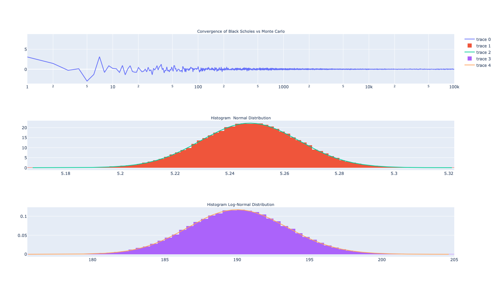

# Qfin-
Repository of small qfin pet projects to test and understand concepts
 
 

 
-> Montecarlo Simulation of European Call Option 
-> The graph shows convergence of Montecarlo  vs Black-Scholes analytical distribution and distribution of simulated paths 
